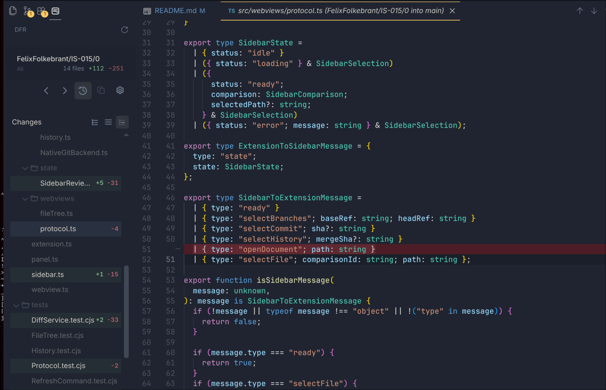

# DFR

A pull-request-style Git branch diff viewer.



## Features

### GitHub- and GitLab-style pull-request reviews

> I wanted to review local commits and branches in the style of GitHub and GitLab merge-request overviews. This extension does exactly that.

- Line-by-line diffs
- Clear marking of deleted and created files
- Commit-by-commit branch review
- Easy copying of the inspected commit's hash
- *Added:* A History view that lets you step through previously merged pull requests as though they were currently under review

### Contextual explorer view

> Reviewing changed code in pull requests can make it easy to lose track of where you are in the codebase. The contextual view shows where changed files sit within the repository as a whole.

  

## Requirements

- VS Code 1.85.0 or newer on desktop.
- Git installed and available on `PATH`.
- An open Git repository on a local branch.
- VS Code's built-in Git extension enabled.

## Installation

The extension is not currently published to the extension store.

To build and install the extension from this checkout:

```bash
pnpm install
pnpm install:local
```

This requires the VS Code `code` command to be available on your `PATH`. In VS Code, open the Command Palette and run **Shell Command: Install 'code' command in PATH** if it is not available. The command builds `dfr.vsix`, then installs or replaces the local extension. Reload VS Code if it does not appear immediately.
