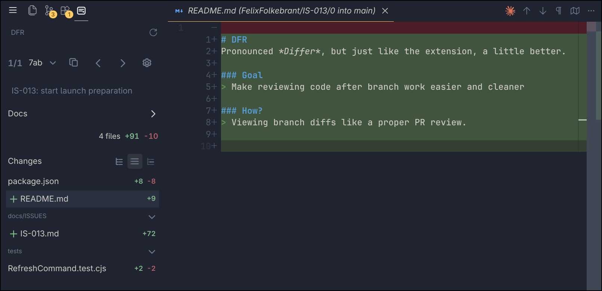
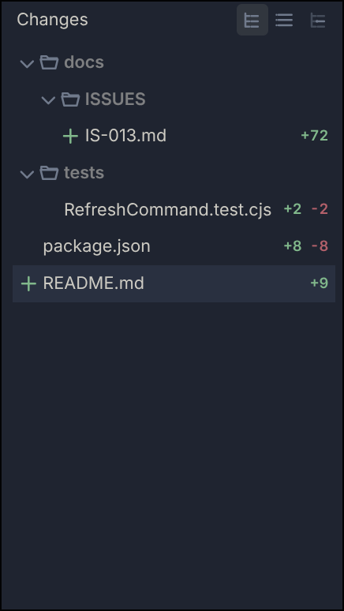
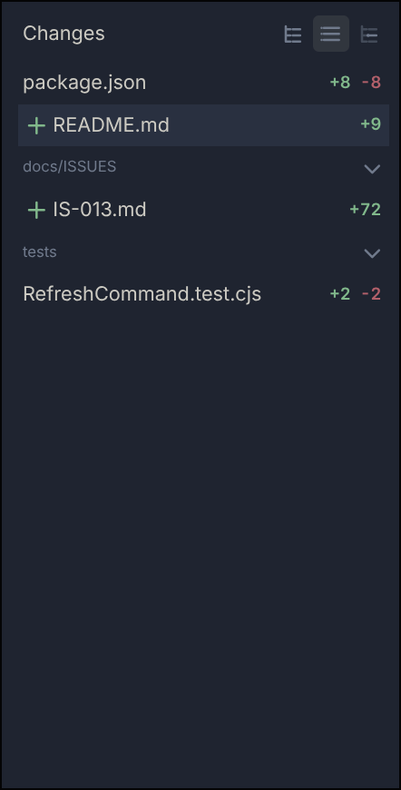
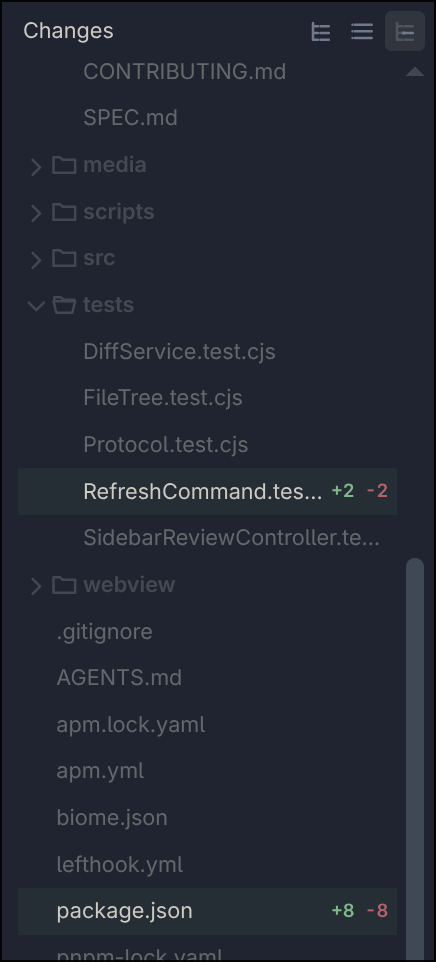

# DFR

Pronounced *Differ*, but just like the extension, a little better.

DFR is a focused local review surface for the changes a branch introduces. It brings a pull-request-style file and commit workflow into VS Code without creating a pull request or leaving the editor.



## Features

- Compare any local or remote branch with another branch using merge-base semantics.
- Review the whole branch or step through individual commits.
- See changed files, status, additions, and deletions in tree, flattened, or contextual views.
- Open selected files in VS Code's native diff editor.
- Open Markdown issue and documentation files associated with the review.
- Copy the selected commit hash and choose how commit names are displayed.

## Requirements

- VS Code 1.85.0 or newer on desktop.
- Git installed and available on `PATH`.
- An open Git repository on a local branch.
- VS Code's built-in Git extension enabled.

## Installation

After the public release, find **DFR** in the VS Code Extensions view and select **Install**.

To test a packaged build before publication:

```bash
code --install-extension dfr-0.0.1.vsix
```

## Review a branch

1. Open a Git repository in VS Code and check out the branch you want to review.
2. Select **DFR** in the Activity Bar. DFR compares the current branch with the configured base branch, or the first available branch from `main`, `master`, `origin/main`, and `origin/master`.
3. Use the scope dropdown to review **All** changes or select an individual commit. The arrow buttons step through commits.
4. Select the settings button to change the review branch, comparison branch, or commit naming.
5. Choose tree, flattened, or contextual file display.
6. Select a changed file to open its diff in VS Code's native diff editor.
7. Use **DFR: Refresh** from the Command Palette or the sidebar title to reload repository state.

## File views

The tree view groups changed files by directory. The flattened view collapses directory paths. The contextual view shows changed files within the surrounding repository structure.

  

## Settings

| Setting | Default | Description |
| --- | --- | --- |
| `branchDiffReview.defaultBaseBranch` | Empty | Preferred comparison branch. DFR falls back to `main`, `master`, `origin/main`, then `origin/master` when the configured branch is empty or unavailable. |

## Known limitations

- DFR supports Git repositories only and requires a named local branch; detached `HEAD` is not supported.
- DFR is a desktop/workspace extension and does not run in browser-only VS Code environments.
- Binary files are identified but cannot be rendered in the text diff editor.
- DFR reviews committed branch history. It does not create pull requests, post comments, stage changes, or resolve conflicts.
- In multi-repository workspaces, DFR uses the repository containing the active editor or asks you to select one when starting or refreshing.

## License

[MIT](LICENSE)
