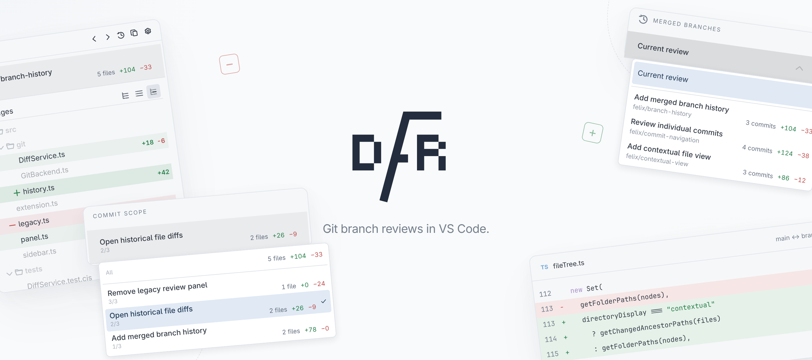
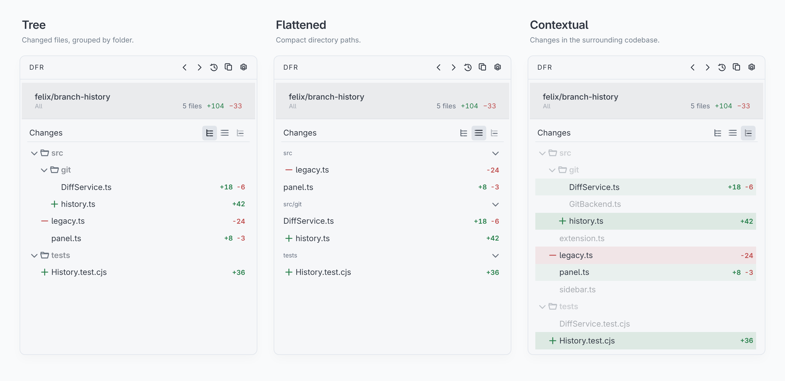

<picture>
  <source media="(prefers-color-scheme: dark)" srcset="media/screenshots/banner-dark.png">
  
</picture>

<p align="center">
  <a href="#features">Features</a> · <a href="#installation">Installation</a> · <a href="docs/CONTRIBUTING.md">Contributing</a> · <a href="LICENSE">MIT license</a>
</p>

## Features

- Review local branches in VS Code's diff editor, with additions, deletions, and per-file change counts.
- See all branch changes or step through individual commits. Copy the inspected commit's hash from the toolbar.
- Revisit merged branches in the History view and review their commits and diffs.
- Switch between tree, flattened, and contextual file views to see changes within the repository.

<picture>
  <source media="(prefers-color-scheme: dark)" srcset="media/screenshots/file-views-dark.png">
  
</picture>

## Installation

DFR isn't published to the Marketplace yet. Build and install from this checkout:

```bash
pnpm install
pnpm install:local
```

Requires **VS Code 1.85+ on desktop**, with **`git` and `code` on your PATH**. The install command builds `dfr.vsix` and installs or replaces the local extension. Reload VS Code, open a local Git repository on a branch, and select **DFR** in the activity bar. VS Code's built-in Git extension must be enabled.

If `code` is missing, run **Shell Command: Install 'code' command in PATH** from VS Code's Command Palette.
